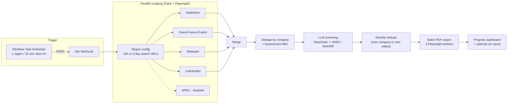
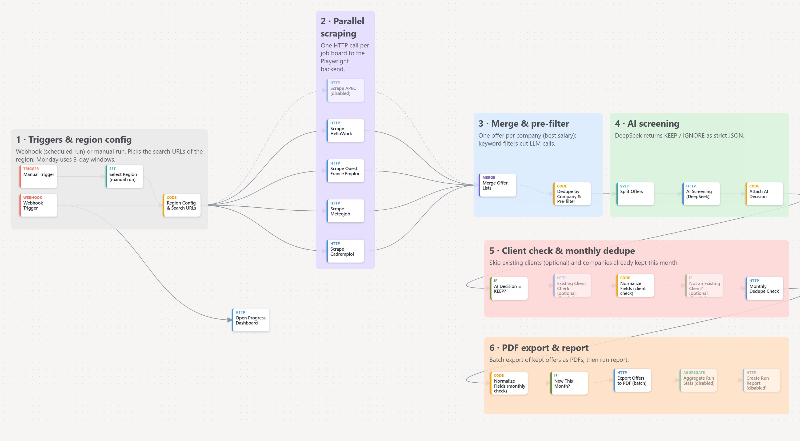

# AD Chase — Automated Job-Offer Prospecting Pipeline

[](https://n8n.io)
[](https://flask.palletsprojects.com)
[](https://playwright.dev)
[](https://www.docker.com)
[](https://www.deepseek.com)

> An end-to-end automation that scans French job boards every working day, filters the offers with rules **and** an LLM, removes duplicates, and delivers a clean, region-sorted set of PDF job ads that a recruitment team can use for business-development outreach — with no manual step.

Built with **n8n + Python (Flask/Playwright) + Docker**. Deployed in production at a recruitment consultancy in Nantes (France) and currently being packaged as a product for recruitment agencies.

---

## The problem

Recruitment consultants prospect new client companies by reading fresh job ads: a company that publishes a senior position is a potential client. Doing this by hand across 12 regions and several job boards means hours of repetitive browsing every week, inconsistent filtering, and the same companies being re-contacted again and again.

## The solution

AD Chase runs the whole routine unattended:

1. **Scrape** the newest offers from several job boards, per region.
2. **Pre-filter** with deterministic rules (cheap, fast, auditable).
3. **Screen** what is left with an LLM that returns a strict `KEEP` / `IGNORE` verdict.
4. **Deduplicate** — one offer per company, best salary kept, and no company repeated within the same month.
5. **Export** the kept offers as PDFs, named and filed by region and month, with a live progress page while the run is going.

**Impact:** at the first consultancy where it was deployed, it saves roughly **3 hours per day** of manual prospecting work (the gain varies with each firm's size and process).

Everything is orchestrated visually in n8n; the parts that need a real browser or the file system live in a small Flask service.

## Architecture



<p align="center">
  <a href="assets/workflow-canvas.png"></a>
  <br><sub>The n8n workflow at a glance (rendered from the exported JSON — click to enlarge)</sub>
</p>

| Layer | Technology | Role |
|---|---|---|
| Orchestration | **n8n** (self-hosted, community edition) | Workflow logic, branching, error paths |
| Backend | **Python / Flask** | Scraping endpoints, monthly state, PDF export, progress page |
| Browser automation | **Playwright (Chromium)** | JS-rendered pages, PDF rendering |
| AI | **DeepSeek `deepseek-chat`** | Sector / seniority screening, JSON output, `temperature = 0.1` |
| Packaging | **Docker Compose** | n8n + Flask on a private bridge network, auto-restart |
| Scheduling | **Windows Task Scheduler** | One region every 20 minutes, Monday to Friday |

## The n8n workflow

[`workflows/ad-chase-v5-job-prospecting.json`](workflows/ad-chase-v5-job-prospecting.json) — 25 nodes, grouped in six annotated sections on the canvas.

| # | Section | What happens |
|---|---|---|
| 1 | Triggers & config | Webhook (or manual run) selects one of 12 regions; Monday uses 3-day search windows to cover the weekend, other days 24 h |
| 2 | Parallel scraping | One HTTP call per job board to the Playwright backend |
| 3 | Merge, dedupe & pre-filter | One offer per company (best salary kept); title / company / description keyword filters remove obvious mismatches **before** any LLM call |
| 4 | AI screening | DeepSeek returns `{"decision": "KEEP\|IGNORE", "reason": "..."}` in JSON mode |
| 5 | Client check & monthly dedupe | Skip companies already kept this month unless the salary changed; an optional cross-check against an existing-client list is available |
| 6 | PDF export & report | Batch export of kept offers as PDFs; an optional run-report step is available |

> **Note** — three optional blocks are switched off in V5: the *existing-client check* (it needs a customer list, which is private), the *run report*, and the **APEC** scraper. APEC's PDF export was repeatedly blocked by anti-bot protection, so I chose to run without it rather than rely on a fragile workaround.

## Engineering decisions worth a look

- **Rules first, LLM second.** A mechanical pre-filter drops obvious non-targets (medical, IT, temp agencies, operational roles…) so the LLM only sees plausible offers. Descriptions are truncated to 300 characters. Result: LLM cost is negligible (≈ €0.04 for ~20 sessions in my measurements) and behaviour is easy to audit.
- **Strict machine-readable AI output.** `response_format: json_object`, low temperature, and a defensive parser that repairs invalid escapes before failing.
- **Idempotent monthly state.** A "keep" memory per region and month prevents the same company from being surfaced twice. Concurrent runs used to overwrite each other; this was fixed with a **per-region lock** and **atomic writes** (write to `.tmp`, then rename, with retries).
- **Batch, not item-by-item, PDF export.** The export call uses n8n's *Execute Once* and sends all offers in one request; item-by-item calls caused race conditions. The backend renders PDFs with a `ThreadPoolExecutor` capped at **3 workers** — the measured ceiling on an 8 GB laptop — and only prints the first 2 pages of each ad.
- **Docker reality checks.** Containers cannot open host browsers or write to mapped Windows network drives, so a tiny host-side helper opens the progress page and PDFs are synced from a local folder instead. Container-to-host traffic goes through `host.docker.internal`.
- **Easy to extend.** Each job board is an independent branch feeding one Merge node: adding a source means one workflow node plus one backend route (Meteojob and Cadremploi were added that way in V5).
- **Compliance-minded scope.** Only publicly available job listings are read. LinkedIn was evaluated and deliberately **excluded** because of its terms of service.

## Project history

The pipeline went through five iterations — from a single-board proof of concept (V1/V2), to three boards with AI filtering (V3), to a fully scheduled, hands-off system (V4), and finally V5 with two additional job boards and the region/URL configuration centralised in the workflow.

## What is in this repository

```
.
├── README.md
├── LICENSE
├── assets/
│   └── workflow-canvas.png                # workflow overview
├── workflows/
│   └── ad-chase-v5-job-prospecting.json   # importable n8n workflow
└── docs/
    └── backend-api.md                     # HTTP contract between n8n and the backend
```

The Flask/Playwright backend is **not published** (it is the commercial core of the product). Its HTTP contract is fully documented in [`docs/backend-api.md`](docs/backend-api.md) so the workflow design can be reviewed end to end.

## Using the workflow

1. Run n8n (self-hosted) and import [`workflows/ad-chase-v5-job-prospecting.json`](workflows/ad-chase-v5-job-prospecting.json) via *Workflows → Import from file*.
2. Create a **Header Auth** credential named e.g. `DeepSeek API` (`Authorization: Bearer <your key>`) and select it on the **AI Screening (DeepSeek)** node.
3. Provide a backend that implements the endpoints in [`docs/backend-api.md`](docs/backend-api.md) at `http://host.docker.internal:8080`.
4. Trigger it with `POST /webhook/ad-chase-trigger` and a multipart field `REGION` (for example `2. BRETAGNE`), or use the manual trigger.

## Responsible use

This project reads public job listings for business-development research. Anyone reusing the approach must check and respect the terms of service and `robots.txt` of each website, and applicable data-protection rules (GDPR). No candidate or personal data is collected.

## License

© 2026 Sandy Giangrasso — all rights reserved. Published for portfolio and evaluation purposes; see [LICENSE](LICENSE).

## Contact

Interested in the product or in working together? Reach me on [LinkedIn](https://www.linkedin.com/in/sandy-giangrasso).
